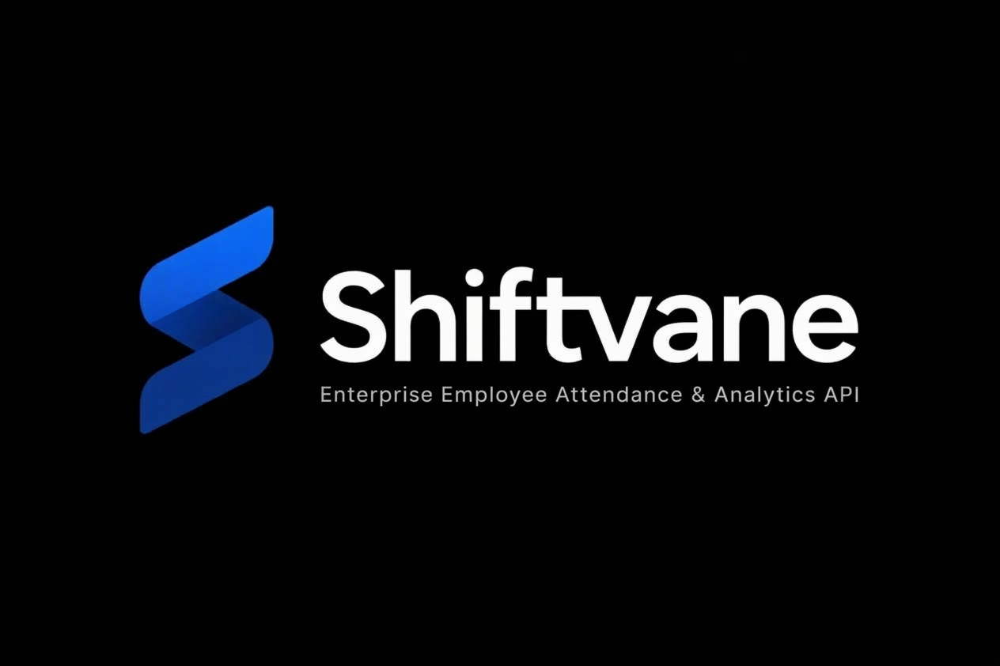

# Shiftvane — Employee Attendance & Analytics API

<p align="center">
  
</p>

<p align="center">
  <strong>An attendance management API built around deterministic shift calculations, auditable corrections, and query-efficient reporting.</strong>
</p>

<p align="center">
  
  
  
  
  
  
</p>

---

## Table of Contents

- [Overview](#overview)
- [The Engineering Problem](#the-engineering-problem)
- [Core Features](#core-features)
- [Architecture](#architecture)
- [Attendance Rules](#attendance-rules)
- [Data Model and Indexes](#data-model-and-indexes)
- [API Reference](#api-reference)
- [Getting Started](#getting-started)
- [Running Tests](#running-tests)
- [Query Plan Diagnostics](#query-plan-diagnostics)
- [Design Decisions and Limitations](#design-decisions-and-limitations)
- [Roadmap](#roadmap)
- [License](#license)

---

## Overview

Shiftvane is a REST API for managing employee attendance, shift schedules, attendance corrections, and operational reporting.

The project focuses on a deceptively difficult part of workforce management: turning punch-in and punch-out timestamps into consistent attendance records that remain useful for payroll preparation, employee reporting, and departmental analysis.

A reliable attendance system must do more than store timestamps. It needs to account for overnight shifts, grace periods, overtime thresholds, rounding rules, duplicate records, and corrections to previously recorded attendance.

Shiftvane implements these rules in a FastAPI application backed by MongoDB. It also provides reporting endpoints and query-plan diagnostics to help examine how attendance data is retrieved.

### What the system supports

- Employee registration with validated employee codes, department assignments, and shift schedules.
- Punch-in and punch-out operations with attendance calculations.
- Overnight shift handling using India Standard Time (IST).
- Attendance regularization with a record of changes and edit reasons.
- Employee-level and department-level analytics.
- Late-arrival frequency rankings.
- MongoDB indexes for common attendance queries.
- Endpoint-level database execution-plan diagnostics.
- Automated API tests using `pytest` and `httpx`.

## The Engineering Problem

Attendance records are simple to store but easy to calculate incorrectly.

Consider an employee whose shift begins at 10:00 PM and ends at 6:00 AM. A punch-in at 11:00 PM and a punch-out at 6:30 AM belong to the same overnight shift, even though the timestamps fall on different calendar dates.

Other cases introduce similar complications:

| Scenario | Engineering concern |
|---|---|
| Overnight shifts | Assign punches to the intended attendance date. |
| Late arrivals | Apply the grace period consistently. |
| Overtime | Ignore excess time that does not meet the configured threshold. |
| Short shifts | Identify work durations below the half-day threshold. |
| Decimal calculations | Avoid inconsistent rounding of hours and averages. |
| Attendance corrections | Preserve the history of changes and their reasons. |
| Growing datasets | Avoid unnecessary full collection scans for frequent queries. |
| Reporting | Calculate employee and department metrics consistently. |

Shiftvane addresses these cases through explicit business rules, database constraints, and query patterns designed around its attendance endpoints.

## Core Features

### 1. Employee Management

- Register employees with unique employee codes.
- Validate employee codes using configured regular-expression rules.
- Associate employees with departments.
- Store employee-specific shift schedules.
- Retrieve employees using paginated listing endpoints.

### 2. Punch-In and Punch-Out

The attendance workflow records employee punches and calculates work-related metrics.

- Determine the attendance date according to the configured IST rules.
- Calculate late arrival using a 10-minute grace period.
- Calculate overtime after the configured 30-minute threshold.
- Flag attendance records with less than four hours of work as half-days.
- Apply half-up rounding to decimal hour calculations.

### 3. Attendance Regularization

Attendance data sometimes needs correction because of missed punches or inaccurate entries.

Shiftvane provides a regularization endpoint that allows attendance records to be adjusted while retaining an audit history.

The intended audit record captures the relevant changes and their reasons, helping distinguish the original attendance information from subsequent corrections.

**Important:** The audit trail's completeness depends on which fields and previous values the implementation records. Verify those details in the regularization service before describing the history as immutable or tamper-proof.

### 4. Employee and Department Analytics

The analytics endpoints provide operational summaries without requiring clients to calculate every metric independently.

- Monthly employee attendance metrics.
- Present, leave, and late-day counts.
- Total overtime.
- Department-level attendance statistics.
- Late-arrival frequency rankings.

These endpoints provide a foundation for attendance dashboards and management reporting.

### 5. Database Query Diagnostics

Shiftvane includes an administrative endpoint for examining MongoDB execution plans:

`GET /admin/explain/{endpoint_name}`

Where supported by the configured endpoint and query parameters, the diagnostics expose MongoDB execution statistics that help identify index usage and investigate expensive queries.

### 6. Automated Testing

The project uses `pytest` and `httpx` to test API behavior.

Testing should cover attendance calculations, API validation, regularization, analytics, and database-dependent edge cases—not just whether endpoints return successful responses.

---

## Architecture

```text
                    Client / API Consumer
                             |
                             | HTTP + JSON
                             v
                    +-------------------+
                    |   FastAPI Routes  |
                    +-------------------+
                             |
                             v
                    +-------------------+
                    | Validation Layer  |
                    |   Pydantic v2     |
                    +-------------------+
                             |
                             v
                    +-------------------+
                    | Attendance Logic  |
                    |                   |
                    | Punch calculations|
                    | Shift/date rules  |
                    | Regularization    |
                    | Analytics         |
                    +-------------------+
                             |
                             v
                    +-------------------+
                    | PyMongo           |
                    | Database Queries  |
                    +-------------------+
                             |
                             v
                    +-------------------+
                    | MongoDB           |
                    |                   |
                    | Employees         |
                    | Attendance Logs   |
                    | Indexes           |
                    +-------------------+
```

### Request lifecycle

1. A client submits an HTTP request.
2. FastAPI routes the request to the appropriate endpoint.
3. Pydantic validates the request data where applicable.
4. The application applies the relevant attendance or reporting logic.
5. PyMongo executes the required database operations.
6. The API returns the response to the client.

Docker Compose provides a convenient way to run the application and its database together during development.

---

## Attendance Rules

Shiftvane uses five explicit business rules to make attendance calculations predictable.

### R1 — Attendance Date and Overnight Shifts

Attendance date assignment uses India Standard Time (IST, UTC+05:30) and the punch-in timestamp.

For overnight shifts, punches before the configured shift end are attributed to the preceding calendar day's shift when the applicable shift rules establish that relationship.

For example:

```text
Shift:             10:00 PM → 06:00 AM

Punch-in:          11:00 PM, Monday
Punch-out:          6:30 AM, Tuesday

Attendance date:   Monday
Work interval:     7 hours 30 minutes
```

The example illustrates the intended overnight-shift behavior; actual results depend on the configured shift schedule and implementation rules.

### R2 — Late Arrival

A 10-minute grace period applies after the official shift start.

```text
Official shift start: 09:00
Grace period ends:    09:10

Arrival at 09:07:     Not late
Arrival at 09:10:     Not late
Arrival at 09:15:     15 minutes late
```

Once the grace period is exceeded, the late duration is measured from the official shift start, not from the end of the grace period.

### R3 — Overtime

Overtime is recorded only when the time worked beyond the scheduled shift end exceeds 30 minutes.

```text
Scheduled shift end:  06:00 PM

Punch-out at 06:20 PM: No overtime
Punch-out at 06:30 PM: No overtime
Punch-out at 06:45 PM: 45 overtime minutes
```

This rule applies the threshold before recording the full excess duration. It does not subtract the threshold from the qualifying overtime duration.

### R4 — Half-Day Classification

An attendance record is flagged as a half-day when its calculated work duration is strictly less than four hours.

```text
3 hours 59 minutes → Half-day
4 hours 00 minutes → Not a half-day under this rule
5 hours 30 minutes → Not a half-day under this rule
```

This classification is separate from any leave policy or approval workflow that may be added later.

### R5 — Half-Up Rounding

Shiftvane uses half-up rounding for decimal hour values and averages.

For example, a value exactly halfway between two hundredths is rounded upward in magnitude rather than using banker's rounding.

Using an explicit rounding rule helps prevent small differences in how work hours and analytics are calculated.

---

## Data Model and Indexes

### Main entities

```text
Employee
   |
   | emp_code
   v
Attendance Log
   |
   +-- Attendance date
   +-- Punch-in timestamp
   +-- Punch-out timestamp
   +-- Work duration
   +-- Late minutes
   +-- Overtime
   +-- Half-day flag
   +-- Regularization history
```

The attendance log is associated with an employee using the employee code. The exact MongoDB document fields and collection definitions should be taken from the current implementation.

### Index strategy

Shiftvane creates indexes for common employee lookup and attendance retrieval patterns.

The configured index definitions are:

```javascript
// Unique employee identifier
{ emp_code: 1 }

// Unique attendance record per employee and date
{ emp_code: 1, date: 1 }

// Attendance listing and sorting
{ date: -1, emp_code: 1 }

// Department-based reporting
{ department: 1, joined_on: 1 }
```

The corresponding collection-level intent is:

| Collection | Index | Purpose |
|---|---|---|
| `employees` | `{ emp_code: 1 }`, unique | Prevent duplicate employee codes. |
| `attendance_logs` | `{ emp_code: 1, date: 1 }`, unique | Enforce one record per employee per attendance date. |
| `attendance_logs` | `{ date: -1, emp_code: 1 }` | Support attendance listing and sorting patterns. |
| `attendance_logs` | `{ department: 1, joined_on: 1 }` | Support queries using the indexed department and date-related fields, if they match the actual query. |

**Why these indexes matter**

- Unique indexes enforce data integrity at the database level.
- Compound indexes can reduce the work required for queries that match their indexed fields and ordering.
- Index selection should be based on actual query predicates and sort order.
- Indexes do not guarantee that every matching query uses an index. MongoDB's query planner chooses a plan based on the query and available indexes.

For that reason, Shiftvane includes execution-plan diagnostics instead of relying only on the existence of index definitions.

---

## API Reference

The following table summarizes the endpoints provided by the project.

| Method | Endpoint | Purpose |
|---|---|---|
| `GET` | `/health` | Check service health. |
| `POST` | `/employees` | Register an employee. |
| `GET` | `/employees` | Retrieve a paginated employee list. |
| `POST` | `/attendance/punch-in` | Create a punch-in record. |
| `POST` | `/attendance/punch-out` | Complete attendance and calculate work metrics. |
| `PATCH` | `/attendance/regularize` | Correct an attendance record and retain audit history. |
| `GET` | `/attendance` | Query and filter attendance records. |
| `GET` | `/attendance/summary` | Retrieve an employee attendance summary. |
| `GET` | `/analytics/employee-monthly` | Calculate monthly employee metrics. |
| `GET` | `/analytics/department-summary` | Retrieve department-level metrics. |
| `GET` | `/analytics/leaderboard` | Rank employees by late-arrival frequency. |
| `GET` | `/admin/explain/{endpoint_name}` | Inspect a supported query's execution plan. |

### Interactive API documentation

When the application is running locally, open:

- Swagger UI: `http://localhost:8000/docs`
- ReDoc: `http://localhost:8000/redoc`
- Health check: `http://localhost:8000/health`

Swagger UI and ReDoc are generated by FastAPI from the registered routes and their OpenAPI definitions.

### Example: Health Check

```http
GET /health
```

Use this endpoint to verify that the service responds. Whether it also checks database connectivity depends on the health endpoint implementation.

### Example: Employee Registration

```http
POST /employees
Content-Type: application/json
```

Use the request schema exposed by `/docs` to submit the employee code, department, and shift details expected by the application.

### Example: Attendance Query

```http
GET /attendance
```

The endpoint supports attendance retrieval and filtering. Consult the generated OpenAPI schema for the exact supported query parameters and pagination defaults.

### Example: Query Execution Plan

```http
GET /admin/explain/attendance_list?emp_code=EMP1001
```

This example illustrates the intended diagnostic workflow. The exact accepted endpoint name and query parameters must match the registered implementation.

---

## Getting Started

### Prerequisites

Choose one of the following environments:

**Option A — Docker**

- Docker Engine or Docker Desktop
- Docker Compose

**Option B — Local Python**

- Python 3.11 or newer
- A running MongoDB instance
- `pip`

### Option A — Run with Docker Compose

**1. Clone the repository**

Replace the URL below with the actual repository URL if it differs.

```bash
git clone https://github.com/ashhuxt/shiftvane.git
cd shiftvane
```

**2. Start the application**

```bash
docker compose up --build -d
```

If the repository uses the older Compose command, `docker-compose up --build -d` may also work.

**3. Check the service**

Open:

- Health: `http://localhost:8000/health`
- Swagger UI: `http://localhost:8000/docs`

To inspect container logs:

```bash
docker compose logs -f
```

To stop the services:

```bash
docker compose down
```

Docker Compose service names, environment variables, ports, and MongoDB persistence depend on the repository's actual Compose configuration.

### Option B — Run Locally

**1. Clone the repository**

```bash
git clone https://github.com/ashhuxt/shiftvane.git
cd shiftvane
```

**2. Create a virtual environment**

Windows PowerShell:

```powershell
python -m venv .venv
.\.venv\Scripts\Activate.ps1
```

Linux or macOS:

```bash
python3 -m venv .venv
source .venv/bin/activate
```

**3. Install dependencies**

```bash
pip install -r requirements.txt
```

**4. Configure environment variables**

Create a `.env` file in the project root:

```env
MONGO_URI=mongodb://localhost:27017
MONGO_DB=shiftvane_db
```

These are the configuration keys supplied for this project. Keep production credentials and connection strings out of version control.

**5. Start the API**

```bash
uvicorn app.main:app --host 0.0.0.0 --port 8000 --reload
```

The API should be available at:

```text
http://localhost:8000
```

Interactive documentation:

```text
http://localhost:8000/docs
```

If your actual application entry point differs from `app.main:app`, use the module path defined by the repository.

---

## Running Tests

Shiftvane uses `pytest` and `httpx` for automated testing.

From the repository root, run:

**Windows PowerShell**

```powershell
$env:PYTHONPATH="."
pytest -v
```

**Linux or macOS**

```bash
PYTHONPATH=. pytest -v
```

To stop after the first failure:

```bash
pytest -x
```

To display additional test output:

```bash
pytest -v -s
```

### Recommended test coverage

| Area | Important cases |
|---|---|
| Employee validation | Valid and invalid employee codes; duplicate identifiers. |
| Attendance dates | Regular shifts, overnight shifts, and punches around midnight. |
| Late calculation | Arrivals before, at, and after the 10-minute grace boundary. |
| Overtime | Excess durations below, at, and above 30 minutes. |
| Half-day classification | Work durations immediately below and at four hours. |
| Rounding | Values below, at, and above half-up rounding boundaries. |
| Regularization | Updated values, recorded reasons, and preserved change history. |
| Database integrity | Duplicate employee/date records and unique index enforcement. |
| Analytics | Empty datasets, multiple departments, and month boundaries. |
| Query plans | Expected index usage for supported query patterns. |

The presence of a test command does not itself establish coverage of every case in this table. These are useful validation targets when extending the suite.

---

## Query Plan Diagnostics

Query performance can deteriorate as attendance records accumulate. Shiftvane provides an administrative execution-plan endpoint to help investigate that behavior.

Example:

```http
GET /admin/explain/attendance_list?emp_code=EMP1001
```

### What to examine

When reviewing MongoDB execution statistics, focus on:

- `winningPlan`: the selected query execution plan.
- `IXSCAN`: whether the plan uses an index scan.
- `COLLSCAN`: whether the plan performs a collection scan.
- `totalKeysExamined`: the number of index keys examined.
- `totalDocsExamined`: the number of documents examined.
- `nReturned`: the number of documents returned.

### Example interpretation

An indexed query may examine a relatively small number of documents to return a result. A collection scan can examine many more documents, particularly when the collection grows.

However, `IXSCAN` alone does not prove that a query is efficient. Compare the number of examined keys and documents with the number of returned results, and inspect the actual filter and sort conditions.

The diagnostic endpoint makes it possible to evaluate these behaviors against real query plans instead of relying on assumptions.

**Security note:** Administrative diagnostics can expose query details and database structure. Restrict access to trusted administrators before exposing the service outside a local development environment.

---

## Design Decisions and Limitations

The current project emphasizes correctness of attendance calculations, auditability, and database access patterns.

### Explicit business rules

Attendance behavior is documented through named rules rather than being scattered across informal assumptions. This makes boundary conditions easier to test and maintain.

### Database-enforced uniqueness

Unique indexes provide a final integrity boundary for employee codes and employee/date attendance records. Application-level checks alone are not sufficient to prevent concurrent duplicate inserts.

### Direct MongoDB access

PyMongo provides direct control over query construction and index-aware access patterns. It also means that document validation, schema evolution, and consistency rules must be designed carefully.

### Areas to validate before production use

- **Concurrent punches:** Confirm that simultaneous punch requests cannot create inconsistent attendance records.
- **Shift boundaries:** Test daylight-independent IST conversion, midnight transitions, and shift schedules that cross calendar dates.
- **Audit integrity:** Verify whether previous values, editor identity, timestamps, and edit reasons are retained and protected against unauthorized modification.
- **Authorization:** Confirm that employee, administrative, and regularization operations enforce the intended access controls.
- **Time-zone consistency:** Store and compare timestamps consistently, and convert to IST at the appropriate business-rule boundary.
- **Index effectiveness:** Confirm query plans against representative data volumes and realistic filter combinations.
- **Operational resilience:** Validate MongoDB connectivity failures, timeouts, and recovery behavior.
- **Sensitive data:** Restrict access to employee records and ensure logs do not expose credentials or unnecessary personal information.

These are validation points, not claims that the current implementation already handles every case.

---

## Roadmap

Possible next steps for Shiftvane include:

- [ ] Add more boundary-focused tests for overnight shifts and punch timing.
- [ ] Expand concurrency tests for duplicate punch and regularization requests.
- [ ] Add role-based access controls if they are not already implemented.
- [ ] Add pagination and sorting controls to all appropriate listing endpoints.
- [ ] Measure query performance using representative attendance datasets.
- [ ] Add metrics for request latency, database errors, and endpoint usage.
- [ ] Add a reporting export for approved attendance summaries.
- [ ] Add integration tests against a dedicated MongoDB test instance.
- [ ] Document deployment configuration, backups, and retention policies.

The roadmap should evolve according to actual user requirements and measured system behavior rather than introducing additional infrastructure without a clear need.

---

## Technology Stack

| Layer | Technology | Role |
|---|---|---|
| Language | Python 3.11+ | Application logic |
| API framework | FastAPI | HTTP endpoints and OpenAPI documentation |
| Database | MongoDB | Employee and attendance persistence |
| Database driver | PyMongo | Database queries and index management |
| Validation | Pydantic v2 | Request and data validation |
| Testing | pytest, httpx | Automated tests and HTTP-level validation |
| Containerization | Docker, Docker Compose | Reproducible development environment |

---

<p align="center">
  <strong>Shiftvane</strong><br/>
  Consistent attendance calculations. Traceable corrections. Measurable database behavior.
</p>
